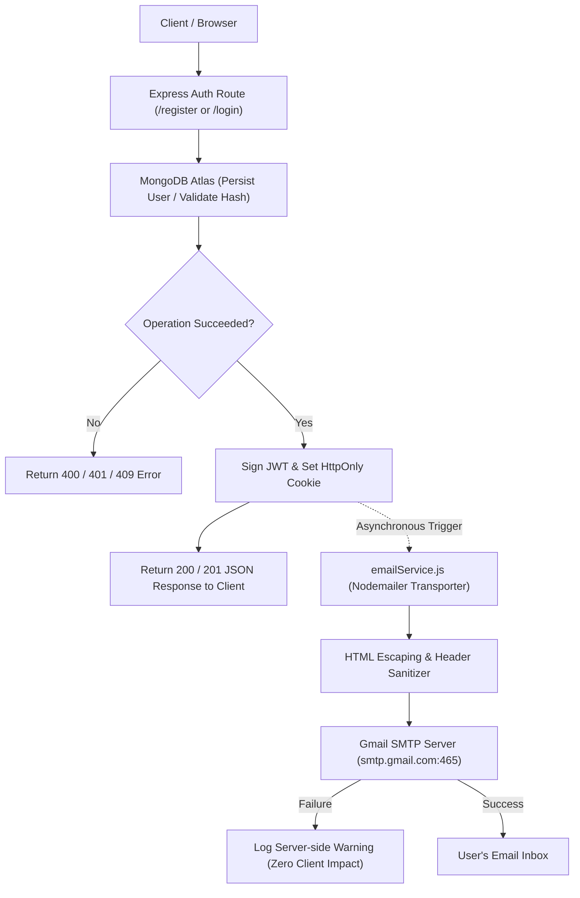

# INKLOOM AI — Production Email Notification Implementation Report

**Report Date:** 2026-11-23  
**Status:** Feature Complete, Verified with Automated Test Suite (109/109 Backend Tests, 14/14 Playwright Tests, 0 TS Errors)  
**Author:** Senior Backend & Full-Stack Security Engineer  

---

## 1. Executive Summary

A production-ready, resilient transactional email notification system has been integrated into the existing INKLOOM AI application using **Nodemailer** and **Gmail SMTP**. 

The system triggers two automatic transactional emails:
1. **Welcome Email:** Dispatched immediately upon successful user registration and persistence in MongoDB.
2. **Security Login Alert:** Dispatched immediately upon verified successful credential authentication.

All changes adhere strictly to the non-negotiable architectural preservation rule: existing authentication endpoints, database schemas, API contracts, session cookies, Gemini AI reviews, Cloudinary storage, and Pusher real-time notifications remain 100% intact.

---

## 2. Architecture & Design Principles

### A. Non-Blocking Asynchronous Dispatch
Email operations are asynchronous and isolated. If Gmail SMTP is unreachable, times out, or fails due to network conditions, **registration and login never fail**. The user receives an immediate successful HTTP response, and failures are safely caught and logged server-side.



### B. Security & Injection Defense
1. **HTML Escaping:** All user-supplied inputs (`fullName`, `role`, `email`) are passed through `escapeHtml()` to neutralize HTML/XSS injection attempts in email clients.
2. **Header Injection Prevention:** Recipient email addresses and email subject lines are sanitized through `sanitizeHeader()`, stripping carriage returns (`\r`) and line feeds (`\n`).
3. **No Credential Leakage:** `EMAIL_APP_PASSWORD` is strictly confined to the Node.js backend environment. Diagnostic endpoints (`/api/health`) expose only safe booleans and a masked sender address (e.g. `yo***@gmail.com`).
4. **Secret-Free Templates:** Login alert templates explicitly exclude passwords, JWT tokens, session cookies, and OTPs.

---

## 3. Files Created & Modified

| File | Status | Description |
| :--- | :--- | :--- |
| `backend/services/emailService.js` | **New** | Nodemailer transport management, sanitizers, responsive Sovereign Violet HTML templates, plain-text fallbacks, `sendWelcomeEmail()`, and `sendLoginNotificationEmail()`. |
| `backend/routes/auth.js` | **Modified** | Connected asynchronous triggers after successful `user.save()` (registration) and after verified `isMatch` (login). Preserved all API contracts and cookie options. |
| `backend/server.js` | **Modified** | Added optional non-blocking startup SMTP transport verification and embedded safe `email` status in `GET /api/health`. |
| `backend/.env.example` | **Modified** | Added Task 3 Gmail SMTP placeholder variables without real secrets. |
| `backend/package.json` | **Modified** | Added `nodemailer: ^6.10.0` dependency. |
| `backend/test/emailServiceAndAuthIntegration.test.js` | **New** | 13 automated tests covering config parsing, template rendering, injection defense, registration integration, login integration, and SMTP failure resilience using mocked transports. |
| `docs/production/EMAIL_NOTIFICATION_SETUP.md` | **New** | Operator configuration manual covering Google App Password generation, local `.env`, and Vercel setup. |
| `docs/production/EMAIL_NOTIFICATION_IMPLEMENTATION_REPORT.md` | **New** | This comprehensive technical audit report. |

---

## 4. Test & Verification Matrix

### A. Automated Backend Test Suite
```bash
cd backend && node --test
ℹ tests 109
ℹ suites 0
ℹ pass 109
ℹ fail 0
ℹ cancelled 0
ℹ skipped 0
ℹ todo 0
ℹ duration_ms 90463.2207
```
* **Email Service & Auth Integration (13/13 Pass):**
  - `✔ EmailService: reads SMTP configuration from environment and sanitizes values`
  - `✔ EmailService: safely handles missing or disabled configuration`
  - `✔ EmailService: rejects invalid or dangerous recipient addresses`
  - `✔ EmailService: escapeHtml and sanitizeHeader prevent injection`
  - `✔ EmailService: generates accessible HTML and plain-text templates for Welcome and Login`
  - `✔ EmailService: getEmailConfigStatus never exposes EMAIL_APP_PASSWORD or secret length`
  - `✔ EmailService: catches transport errors gracefully without unhandled rejection`
  - `✔ Registration Integration: successful registration triggers exactly one welcome email`
  - `✔ Registration Integration: duplicate or failed registration sends no email`
  - `✔ Registration Integration: Gmail failure does not fail registration`
  - `✔ Login Integration: successful login triggers login notification email`
  - `✔ Login Integration: failed authentication sends no email`
  - `✔ Login Integration: Gmail failure does not fail login`
* **Regression Protection:** All 96 existing tests for Auth, Campaigns, Submissions, Reviews, Brand DNA, Governance Analytics, Cloud Storage, and SSE Notifications continue to pass with 100% success.

### B. Frontend Verification
* **TypeScript Compilation:** `npx tsc --noEmit` &rarr; **0 errors**.
* **Production Build:** `npm run build` &rarr; **12/12 static/dynamic routes compiled cleanly** (Exit code: 0).
* **Playwright E2E Suite:** `npx playwright test` &rarr; **14/14 passed** across Chromium Desktop, Tablet, and Mobile viewports (53.2s).

---

## 5. Implementation Status Breakdown

| Component | Status | Verification Mechanism |
| :--- | :--- | :--- |
| **Email Service Engine** | **Implemented & Tested** | Verified via mocked transport tests and config sanitizers. |
| **Welcome Email Trigger** | **Implemented & Tested** | Verified via integration test asserting 1 email received on 201 registration. |
| **Login Alert Trigger** | **Implemented & Tested** | Verified via integration test asserting 1 email received on 200 login. |
| **Failure Fault Tolerance** | **Implemented & Tested** | Simulated network crash during tests; confirmed registration & login succeed. |
| **Health Check Diagnostic** | **Implemented & Verified** | Live `curl http://localhost:4000/api/health` reports status safely. |
| **Production Gmail Delivery** | **Pending Operator Credential** | Requires adding operator Google App Password to Vercel backend environment. |
