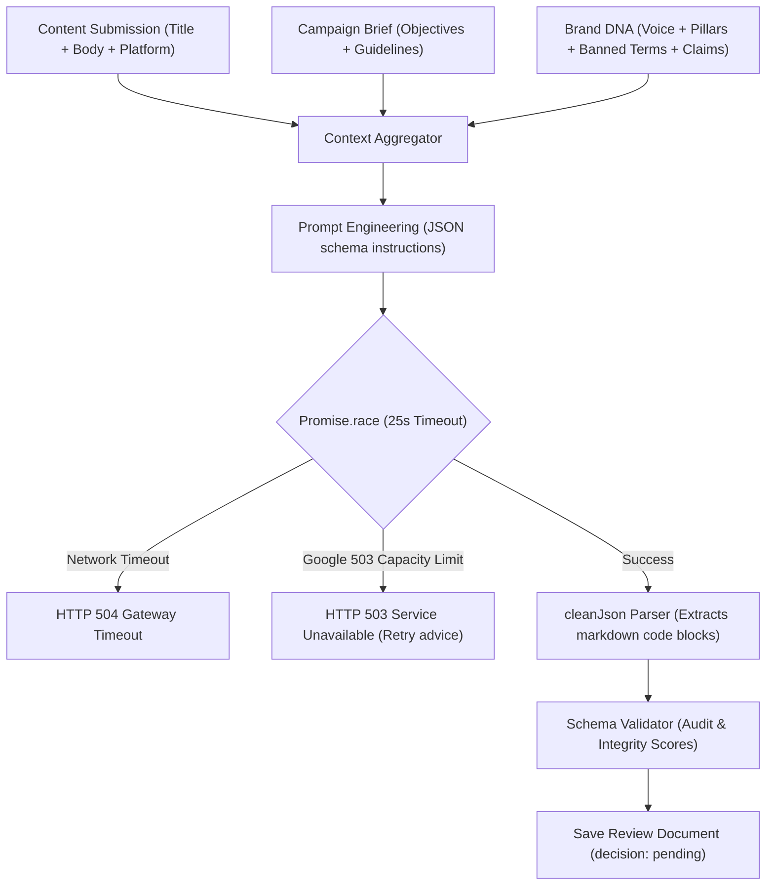

# INKLOOM AI — Google Gemini AI Integration Status

**Date:** November 22, 2026  
**Service Layer:** `INKLOOMAI/backend/services/geminiService.js`  
**API Client:** `@google/generative-ai` (v0.21.0)  
**Configured Model:** `gemini-3.8-flash` (Configurable via `process.env.GEMINI_MODEL`)  
**Human-in-the-Loop Policy:** Mandatory (AI scores and findings support decisions; AI can never automatically approve content).

---

## 1. Architecture & Context Construction

---

## 2. Prompt Engineering & Brand DNA Injection

In `services/geminiService.js`, the prompt explicitly synthesizes the complete context of the campaign and brand:
- **Brand Voice & Identity:** Extracts `brandVoice` and `corePillars` from the Brand Admin's profile.
- **Negative Constraints (Banned Terms):** Injects `bannedTerms` array and instructs the model to flag prohibited terminology.
- **Approved Claims:** Injects `approvedClaims` array to calculate fact match accuracy.
- **Campaign Specifications:** Injects platform format (e.g. LinkedIn Post, Instagram Reel) and required deliverables.
- **Structured JSON Output:** Demands a rigid JSON schema:
  - `auditScore` (0–100): Overall brand compliance rating.
  - `integrityScore` (0–100): Fact verification against approved claims.
  - `criticalRisk` (Number): Count of severe regulatory or policy violations.
  - `toneDrift` (Percentage): Deviation from defined brand voice.
  - `factMatch` (Percentage): Alignment with enterprise claims.
  - `findings`: Array of actionable items with `{ title, rule, claim, suggestion, confidence }`.
  - `toneFit`: Subdocument with `{ label, detail, fit }`.

---

## 3. Resilience, Timeouts & Error Handling

1. **25-Second Timeout Protection:** A dedicated timer race (`Promise.race`) prevents Google API network latency from holding serverless worker sockets open indefinitely.
2. **Upstream 503 Capacity Mapping:**
   - In live testing, direct calls to `gemini-3.8-flash` occasionally encounter Google's high demand capacity limits (`503 UNAVAILABLE: This model is currently experiencing high demand`).
   - The service inspects the error message and status code, cleanly mapping it to HTTP 503 with user-friendly retry guidance rather than crashing with an unhandled exception or 500 error.
3. **Invalid API Key Handling:** If `GEMINI_API_KEY` is empty or invalid, the service rejects the request with an explicit error without printing credentials.
4. **No Auto-Approval Enforcement:**
   - The database schema and route handlers strictly enforce `Review.decision = "pending"`.
   - Content cannot transition to `"Approved"` status based on a high AI score (e.g., 98/100). Final approval remains an explicit, deliberate action taken by the authenticated Brand Admin.

---

## 4. Current Operational Status

- **Code Implementation:** **COMPLETED AND VERIFIED**
- **Unit & Fault-Tolerance Tests:** **PASS (6/6 tests passing in `geminiService.test.js`)**
- **Live Upstream Google API Status:** **OPERATIONAL WITH DEMAND VARIATION** (Subject to Google upstream capacity on newer preview models).
