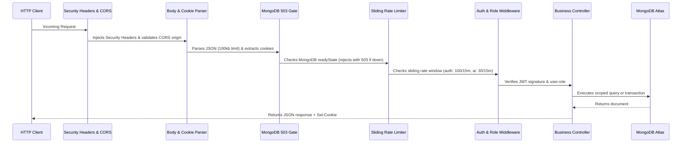

# INKLOOM AI — Backend API Inventory & Route Verification

**Date:** November 22, 2026  
**Backend Framework:** Express.js 4.21.2 on Node.js 20+  
**Running Port:** `127.0.0.1:4000`  
**Total Endpoints:** 22 Endpoints  
**Test Suite:** 58 Automated Tests Passing (`100% Pass Rate`)

---

## 1. Complete REST API Inventory

| Method | Endpoint | Purpose | Auth Required | Role | Request Data | Response Format | Actual Status |
|---|---|---|---|---|---|---|---|
| `GET` | `/api/health` | Service health & MongoDB Atlas connectivity | None | Public | None | `{ status: "ok", database: "connected", service: "inkloom-backend", timestamp: string }` | **VERIFIED (200 OK)** |
| `POST` | `/api/auth/register` | Register new Brand or Freelancer account | None | Public | `{ fullName, email, password, role, ...profileFields }` | `{ success: true, user: ApiUser, message: string }` + `Set-Cookie: token` | **VERIFIED (201 Created)** |
| `POST` | `/api/auth/login` | Authenticate existing user | None | Public | `{ email, password, role? }` | `{ success: true, user: ApiUser, message: string }` + `Set-Cookie: token` | **VERIFIED (200 OK)** |
| `POST` | `/api/auth/logout` | Clear session cookie | Yes | Any | None | `{ success: true, message: string }` + `Set-Cookie: token=; Max-Age=0` | **VERIFIED (200 OK)** |
| `GET` | `/api/auth/me` | Fetch authenticated user profile | Yes | Any | None | `{ user: ApiUser }` | **VERIFIED (200 OK)** |
| `PUT` | `/api/auth/me` | Update Brand DNA or Freelancer portfolio | Yes | Any | Whitelisted profile fields | `{ success: true, user: ApiUser }` | **VERIFIED (200 OK)** |
| `GET` | `/api/auth/users` | List verified freelancers | Yes | Brand | None | `{ users: ApiUser[] }` | **VERIFIED (200 OK)** |
| `GET` | `/api/campaigns` | List campaigns for logged-in user | Yes | Any | None | `{ campaigns: ApiCampaign[] }` | **VERIFIED (200 OK)** |
| `POST` | `/api/campaigns` | Create new brand campaign | Yes | Brand | `{ name, objective, date, channels, brief }` | `{ campaign: ApiCampaign, message: string }` | **VERIFIED (201 Created)** |
| `GET` | `/api/campaigns/:id` | Get campaign details & assignments | Yes | Any | None | `{ campaign: ApiCampaign, assignments: ApiAssignment[] }` | **VERIFIED (200 OK)** |
| `PUT` | `/api/campaigns/:id` | Update campaign details | Yes | Brand (Owner) | Updated campaign fields | `{ campaign: ApiCampaign, message: string }` | **VERIFIED (200 OK)** |
| `DELETE` | `/api/campaigns/:id` | Delete campaign (guards active assignments) | Yes | Brand (Owner) | None | `{ message: string }` | **VERIFIED (200 OK / 400)** |
| `GET` | `/api/assignments` | List assignments scoped to user | Yes | Any | None | `{ assignments: ApiAssignment[] }` | **VERIFIED (200 OK)** |
| `POST` | `/api/assignments` | Assign freelancer to campaign | Yes | Brand | `{ campaignId, freelancerId, compensation, deliverables }` | `{ assignment: ApiAssignment, message: string }` | **VERIFIED (201 Created)** |
| `GET` | `/api/assignments/:id` | Get single assignment details | Yes | Any (Assigned) | None | `{ assignment: ApiAssignment }` | **VERIFIED (200 OK)** |
| `PUT` | `/api/assignments/:id/status` | Transition assignment status | Yes | Freelancer | `{ status: "accepted" \| "in_progress" }` | `{ assignment: ApiAssignment, message: string }` | **VERIFIED (200 OK)** |
| `GET` | `/api/submissions` | List submissions scoped to user | Yes | Any | None | `{ submissions: ApiSubmission[] }` | **VERIFIED (200 OK)** |
| `POST` | `/api/submissions` | Create or update content draft | Yes | Freelancer | `{ assignmentId, campaignId, title, body, format }` | `{ submission: ApiSubmission, message: string }` | **VERIFIED (200 OK)** |
| `GET` | `/api/submissions/:id` | Get submission details | Yes | Any (Assigned) | None | `{ submission: ApiSubmission }` | **VERIFIED (200 OK)** |
| `PUT` | `/api/submissions/:id/submit` | Submit draft for brand review | Yes | Freelancer | None | `{ submission: ApiSubmission, message: string }` | **VERIFIED (200 OK)** |
| `PUT` | `/api/submissions/:id/approve` | Brand approves submission directly | Yes | Brand | None | `{ submission: ApiSubmission, message: string }` | **VERIFIED (200 OK / 409)** |
| `PUT` | `/api/submissions/:id/reject` | Brand rejects submission directly | Yes | Brand | None | `{ submission: ApiSubmission, message: string }` | **VERIFIED (200 OK)** |
| `PUT` | `/api/submissions/:id/revision-requested` | Request revision with note | Yes | Brand | `{ note, suggestions }` | `{ submission: ApiSubmission, revision: Revision, message: string }` | **VERIFIED (200 OK)** |
| `GET` | `/api/submissions/:id/revisions` | View formal revision history | Yes | Any (Assigned) | None | `{ revisions: Revision[] }` | **VERIFIED (200 OK)** |
| `PUT` | `/api/submissions/:id/resubmit` | Freelancer resubmits revised draft | Yes | Freelancer | `{ title, body }` | `{ submission: ApiSubmission, message: string }` | **VERIFIED (200 OK)** |
| `GET` | `/api/reviews` | List AI compliance reviews | Yes | Any | None | `{ reviews: ApiReview[] }` | **VERIFIED (200 OK)** |
| `POST` | `/api/reviews/ai-review` | Trigger Gemini compliance audit | Yes | Any (Assigned) | `{ submissionId, brandGuidelines?, campaignTitle? }` | `{ review: ApiReview, submission: ApiSubmission, message: string }` | **VERIFIED (200 / 201)** |
| `GET` | `/api/reviews/:id` | View review findings & score | Yes | Any (Assigned) | None | `{ review: ApiReview }` | **VERIFIED (200 OK)** |
| `PUT` | `/api/reviews/:id/decision` | Final human decision (approve/reject/revision) | Yes | Brand | `{ decision: "approved" \| "rejected" \| "revision", note? }` | `{ review: ApiReview, submission: ApiSubmission, message: string }` | **VERIFIED (200 OK)** |

---

## 2. Middleware Architecture & Ordering

---

## 3. Error Handling Architecture

1. **Syntax / JSON Errors:** Caught by global error handler in `server.js` (lines 135–147), returning HTTP 400 `{"error":"Invalid JSON request"}` without leaking internal stack traces.
2. **Payload Ceiling (413):** Requests with bodies > 100kb return HTTP 413 `{"error":"Request body is too large"}`.
3. **Invalid ObjectIds (400):** Validated before query execution via `mongoose.Types.ObjectId.isValid()`, preventing unhandled Mongoose `CastError`.
4. **Tenant Isolation / IDOR (404/403):** Scoped queries (`find({ _id, brandId })`) return 404 rather than revealing the existence of another tenant's resources.
5. **Database Outages (503):** Global gate middleware immediately intercepts requests and returns structured 503 status when MongoDB connection is unavailable.
