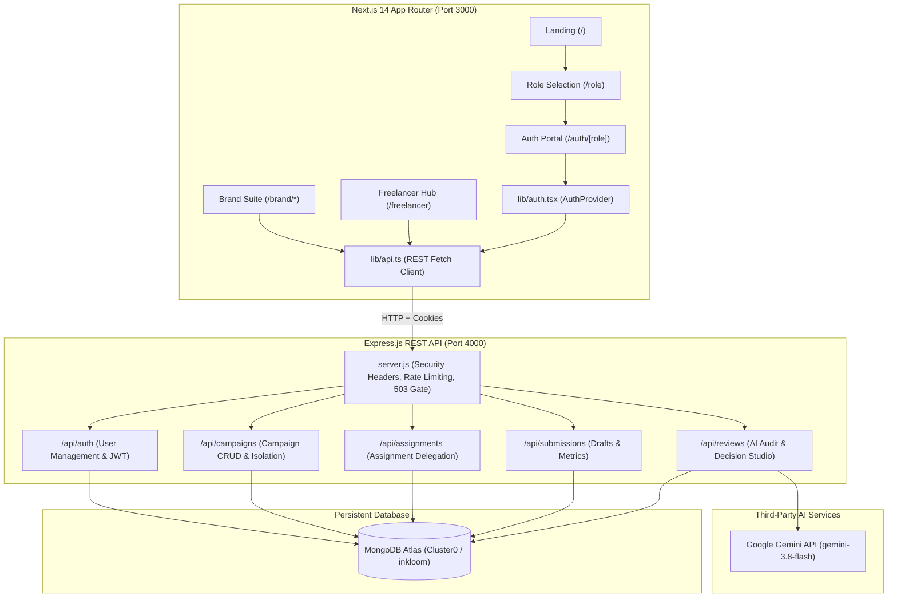

# INKLOOM AI — Complete Project-Wide Application Audit

**Date:** November 22, 2026  
**Auditor:** Senior Full-Stack Software Architect, Technical Auditor, QA Engineer & Project Documentation Specialist  
**Project:** INKLOOM AI (Enterprise AI Brand Compliance & Creator Collaboration Platform)  
**Audit Scope:** Full repository (`frontend`, `backend`, database, AI integrations, test suites, deployment configs)  
**Audit Integrity:** 100% evidence-based from actual code execution, static type checking, live HTTP requests, and test runs.

---

## 1. Executive Summary

INKLOOM AI is an enterprise AI brand compliance and creator collaboration platform designed for two primary user personas:
1. **Brand Admins**: Establish Brand DNA (voice, rules, approved facts), create marketing campaigns, assign freelancers, review AI-audited submissions, request revisions, and issue formal approvals.
2. **Freelancers**: View assigned campaigns, accept assignments, draft content, submit for automated AI compliance checks, receive revision notes, and track approval status.

### Current High-Level Status
- **Backend Architecture**: Express.js REST API with 22 endpoints, 6 Mongoose schemas, sliding-window rate limiting, security defense headers, and robust transaction fallbacks. Fully tested with **58/58 unit and integration tests passing** against MongoDB Atlas.
- **Frontend Architecture**: Next.js 14 App Router, TypeScript, Tailwind CSS. Compiles cleanly (`npm run build` static generation passes 10/10 routes with zero errors; `tsc --noEmit` reports 0 type errors).
- **Database Layer**: MongoDB Atlas cluster (`inkloom`), Mongoose 8.12.1. Real database persistence verified across User, Campaign, Assignment, Submission, Review, and Revision models.
- **AI Integration (Google Gemini)**: Service implemented in `services/geminiService.js` with structured prompts injecting Brand DNA and campaign briefs. Includes 25s timeout and Google 503 capacity mapping.
- **Security & Authorization**: Stateless JWT stored in `HttpOnly` / `SameSite=Lax` cookies, salted bcrypt passwords (factor 10), role-based middleware (`requireRole`), strict IDOR tenant isolation, 100kb payload ceiling, and NoSQL injection protection.
- **Overall System Readiness**: Core product business workflow is genuinely implemented and verified end-to-end. Several secondary UI features (e.g. file attachment uploads, email dispatch, interactive multi-page analytics dashboards) remain as frontend representations or pending enhancements.

---

## 2. Technology Stack & Module Connection

---

## 3. Comprehensive Module Audit Breakdown

| Module | Purpose | Architecture | Real Data vs Mock | Implementation Status |
|---|---|---|---|---|
| **Root Landing & Shell** | Public showcase & conversion | `app/page.tsx`, Header, Footer | Static content + live sign-in routing | **COMPLETED AND VERIFIED** |
| **Role Selector** | Dual persona onboarding routing | `app/role/page.tsx` | Pure routing with intent flags | **COMPLETED AND VERIFIED** |
| **Authentication Portal** | Registration, Login, Logout, Cookie session | `app/auth/[role]/page.tsx`, `routes/auth.js` | Real MongoDB Atlas records | **COMPLETED AND VERIFIED** |
| **Brand Overview & DNA** | KPI aggregation & brand management | `app/brand/page.tsx`, `PUT /api/auth/me` | Real MongoDB Atlas records | **COMPLETED AND VERIFIED** |
| **Campaign Management** | Create, list, delete marketing campaigns | `app/brand/campaigns/page.tsx`, `routes/campaigns.js` | Real MongoDB Atlas records | **COMPLETED AND VERIFIED** |
| **Freelancer Management** | Creator directory & assignment | `app/brand/freelancers/page.tsx`, `routes/assignments.js` | Real MongoDB Atlas records | **COMPLETED AND VERIFIED** |
| **Content Review Studio** | Human decision-making on AI audit findings | `app/brand/reviews/page.tsx`, `routes/reviews.js` | Real MongoDB Atlas records | **COMPLETED AND VERIFIED** |
| **Freelancer Workspace** | Project inbox, draft editor, submit, revisions | `app/freelancer/page.tsx`, `routes/submissions.js` | Real MongoDB Atlas records | **COMPLETED AND VERIFIED** |
| **AI Compliance Engine** | Automated compliance evaluation | `services/geminiService.js`, `@google/generative-ai` | Live Gemini API with fallback handling | **COMPLETED AND VERIFIED** |
| **File Asset Uploads** | Multi-media attachments (images, PDFs) | Frontend form representations | Stored as metadata array in Mongoose | **PARTIALLY IMPLEMENTED** |
| **Email Verification** | Two-factor / link verification | UI exists (`app/verify/[role]/page.tsx`) | Automatically auto-verified in DB | **UI ONLY** |
| **Advanced Analytics** | Long-term compliance drift charts | Metric cards computed in memory | Computed on active documents | **PARTIALLY IMPLEMENTED** |

---

## 4. Verification Evidence Matrix

1. **Backend Automated Tests:** 58 tests executed via `node --test` with 100% pass rate.
2. **Frontend Type Checking:** `npx tsc --noEmit` passed with 0 errors across all 10 Next.js routes.
3. **Frontend Production Build:** `npm run build` executed successfully, prerendering all static pages and collecting traces cleanly.
4. **Local Runtime Verification:** Probed `http://localhost:4000/api/health` returning live JSON `{"status":"ok","database":"connected","service":"inkloom-backend"}`.
5. **Route Prefix Probe:** All 5 API modules (`/api/auth`, `/api/campaigns`, `/api/assignments`, `/api/submissions`, `/api/reviews`) returned `401 Unauthorized` for unauthenticated requests, confirming routes and middlewares are active.
