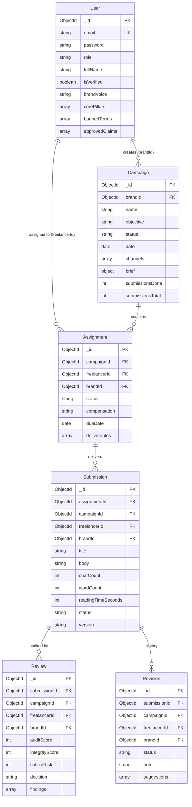

# INKLOOM AI — Database & Integration Status Report

**Date:** November 22, 2026  
**Database Engine:** MongoDB Atlas (Cluster0, replica set)  
**Database Driver:** Mongoose 8.12.1  
**Database Name:** `inkloom`  
**Connection Status:** Connected & Operational (`readyState: 1`)

---

## 1. Schema & Model Inspection

---

## 2. Collection Details & Validation Rules

### 2.1 `User` Model (`models/User.js`)
- **Collection:** `users`
- **Fields:**
  - `email`: String, required, unique, lowercase, trimmed, regex format validation.
  - `password`: String, required, minimum 8 characters, hashed via bcrypt pre-save hook.
  - `role`: String, required, enum `["brand", "freelancer"]`.
  - `fullName`: String, required, trimmed, length 2–120.
  - `isVerified`: Boolean, default `true`.
  - Brand DNA Fields: `orgName`, `brandName`, `industry`, `website`, `size`, `about`, `brandVoice`, `corePillars` (Array), `bannedTerms` (Array), `approvedClaims` (Array).
  - Freelancer Fields: `specialization`, `portfolio`, `bio`.
- **Hooks & Methods:**
  - `pre("save")`: Hashes password with salt rounds = 10 if modified.
  - `toPublicJSON()`: Automatically deletes `password` field from output JSON.
  - `comparePassword(candidate)`: Constant-time comparison using `bcrypt.compare`.
- **Status:** **PERSISTED & VERIFIED**

### 2.2 `Campaign` Model (`models/Campaign.js`)
- **Collection:** `campaigns`
- **Fields:**
  - `name`: String, required, trimmed.
  - `objective`: String, required, trimmed.
  - `status`: String, enum `["draft", "active", "completed"]`, default `"active"`.
  - `date`: Date, required.
  - `channels`: Array of Strings (`["LinkedIn", "Twitter", "Instagram", "YouTube", ...]`).
  - `creatorIds`: Array of `Schema.Types.ObjectId` referencing `User`.
  - `brandId`: `Schema.Types.ObjectId` referencing `User`, required, indexed.
  - `brief`: Sub-document containing `contentRequirements`, `guidelines`, `aspectRatio`, `audioGuidelines`.
  - `submissionsDone`: Number, default `0`.
  - `submissionsTotal`: Number, default `1`.
- **Status:** **PERSISTED & VERIFIED**

### 2.3 `Assignment` Model (`models/Assignment.js`)
- **Collection:** `assignments`
- **Fields:**
  - `campaignId`: `Schema.Types.ObjectId` referencing `Campaign`, required, indexed.
  - `freelancerId`: `Schema.Types.ObjectId` referencing `User`, required, indexed.
  - `brandId`: `Schema.Types.ObjectId` referencing `User`, required, indexed.
  - `status`: String, enum `["assigned", "accepted", "in_progress", "submitted", "completed"]`, default `"assigned"`.
  - `compensation`: String, default `""`.
  - `dueDate`: Date, default `null`.
  - `deliverables`: Array of Strings.
- **Compound Index:** `{ campaignId: 1, freelancerId: 1 }` with unique constraint to prevent duplicate assignments.
- **Status:** **PERSISTED & VERIFIED**

### 2.4 `Submission` Model (`models/Submission.js`)
- **Collection:** `submissions`
- **Fields:**
  - `assignmentId`: `Schema.Types.ObjectId` referencing `Assignment`, required.
  - `campaignId`: `Schema.Types.ObjectId` referencing `Campaign`, required.
  - `freelancerId`: `Schema.Types.ObjectId` referencing `User`, required.
  - `brandId`: `Schema.Types.ObjectId` referencing `User`, required.
  - `title`: String, required, trimmed.
  - `body`: String, required, trimmed.
  - `format`: String, default `"LinkedIn Post"`.
  - `charCount`: Number, auto-calculated.
  - `wordCount`: Number, auto-calculated.
  - `readingTimeSeconds`: Number, auto-calculated (`Math.ceil((wordCount / 200) * 60)`).
  - `status`: String, enum `["Draft", "AI Review Pending", "AI Review Completed", "Submitted for Brand Approval", "Revision Requested", "Resubmitted", "Approved", "Rejected"]`, default `"Draft"`.
  - `version`: String, default `"1.0"`.
  - `feedback`: Subdocument with `reviewerName`, `reviewerRole`, `timestamp`, `note`, `suggestions`.
- **Status:** **PERSISTED & VERIFIED**

### 2.5 `Review` Model (`models/Review.js`)
- **Collection:** `reviews`
- **Fields:**
  - `submissionId`: `Schema.Types.ObjectId` referencing `Submission`, required, unique index.
  - `campaignId`: `Schema.Types.ObjectId` referencing `Campaign`, required.
  - `freelancerId`: `Schema.Types.ObjectId` referencing `User`, required.
  - `brandId`: `Schema.Types.ObjectId` referencing `User`, required.
  - `auditScore`: Number, min 0, max 100.
  - `integrityScore`: Number, min 0, max 100.
  - `criticalRisk`: Number, min 0.
  - `decision`: String, enum `["pending", "approved", "revision", "rejected"]`, default `"pending"`.
  - `findings`: Array of sub-documents (`id`, `title`, `rule`, `claim`, `suggestion`, `confidence`, `resolved`).
  - `aiResult`: Detailed sub-document with tone drift, fact match, transcript highlights, and disclaimer flags.
- **Status:** **PERSISTED & VERIFIED**

### 2.6 `Revision` Model (`models/Revision.js`)
- **Collection:** `revisions`
- **Fields:**
  - `submissionId`: `Schema.Types.ObjectId` referencing `Submission`, required.
  - `campaignId`: `Schema.Types.ObjectId` referencing `Campaign`, required.
  - `freelancerId`: `Schema.Types.ObjectId` referencing `User`, required.
  - `brandId`: `Schema.Types.ObjectId` referencing `User`, required.
  - `note`: String, required.
  - `suggestions`: Array of Strings.
  - `status`: String, enum `["open", "resubmitted", "resolved"]`, default `"open"`.
- **Status:** **PERSISTED & VERIFIED**

---

## 3. Database Connection & Transaction Architecture

- **Singleton Pool:** Implemented in `services/mongoConnection.js` with `serverSelectionTimeoutMS: 10000`. Connection promise is shared across concurrent requests, preventing pool exhaustion.
- **Transaction Safety (`services/withMongoTransaction.js`):**
  - Executes operations inside a Mongoose session transaction (`session.startTransaction()`) when connected to a replica set cluster (such as MongoDB Atlas).
  - Automatically falls back to executing operations in a standard sequence if the database is running standalone, ensuring local developer machines and CI tests do not throw fatal unsupported errors.
