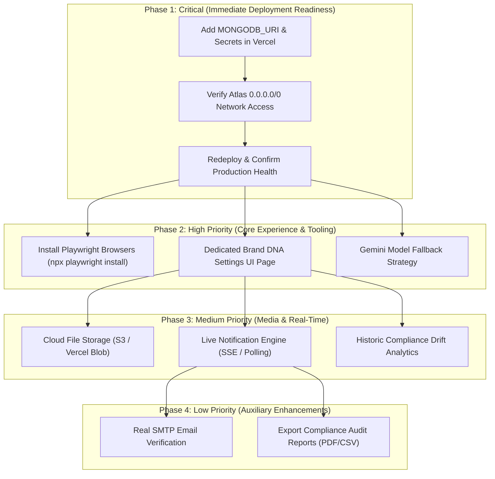

# INKLOOM AI — Prioritised Development Roadmap

**Date:** November 22, 2026  
**Architectural Blueprint:** Post-Audit Engineering Roadmap  
**Scope:** Strictly aligned with INKLOOM AI core platform requirements (No unnecessary out-of-scope bloat).

---

## 1. Prioritised Action Matrix

---

## 2. Detailed Priority Breakdown

### Phase 1: Critical Priority (Immediate Production Blockers)
*Objective: Ensure deployed Vercel application is fully operational and connected to MongoDB Atlas.*

1. **Configure Production Vercel Environment Variables:**
   - **Why:** The deployed frontend displays *"Database unavailable. Configure MONGODB_URI before using the API."* because `process.env.MONGODB_URI` has not been added to the Vercel Project Settings.
   - **Action:** In Vercel Dashboard -> Settings -> Environment Variables, add:
     - `MONGODB_URI`: Atlas connection string (`mongodb+srv://...`)
     - `JWT_SECRET`: 32+ character signing key
     - `GEMINI_API_KEY`: Google Gemini API key
     - `NODE_ENV`: `production`
2. **MongoDB Atlas IP Access Configuration:**
   - **Why:** Vercel serverless functions connect from dynamic cloud IP pools. Static IP whitelisting will cause connection timeouts.
   - **Action:** Ensure `0.0.0.0/0` (Allow access from anywhere) is enabled in Atlas Network Access.
3. **Trigger Production Redeployment:**
   - **Action:** Trigger a redeployment in Vercel to activate the environment variables and test registration live on production.

---

### Phase 2: High Priority (Experience Polish & Test Tooling)
*Objective: Unblock end-to-end browser test automation and provide first-class Brand DNA management.*

4. **Install Playwright Headless Browsers:**
   - **Dependency:** None.
   - **Action:** Run `npx playwright install` in `INKLOOMAI/frontend` to download `chromium_headless_shell`, allowing the 3 Playwright tests in `auth-navigation.spec.ts` to execute locally and in CI.
5. **Dedicated Brand DNA Settings Screen:**
   - **Dependency:** Backend endpoint `PUT /api/auth/me` is already implemented and verified.
   - **Action:** Create a dedicated settings tab inside `/brand` allowing Brand Admins to visually add/remove banned terms, edit approved claims, and configure brand tone descriptors.
6. **Gemini Model Resiliency Configuration:**
   - **Dependency:** Backend `geminiService.js`.
   - **Action:** Add automatic fallback in `geminiService.js` to try `gemini-1.5-flash` or `gemini-2.0-flash` if `gemini-3.8-flash` returns 503 UNAVAILABLE due to peak Google infrastructure demand.

---

### Phase 3: Medium Priority (Asset Storage & Real-Time Sync)
*Objective: Support multi-megabyte media attachments and real-time collaboration.*

7. **Cloud Media Storage Integration:**
   - **Action:** Replace metadata-only asset arrays with direct presigned S3 / Vercel Blob file uploads for high-resolution images and videos attached to submissions.
8. **Real-Time Notification Alerts:**
   - **Action:** Implement lightweight Server-Sent Events (SSE) or short-polling on `/brand/reviews` and `/freelancer` so creators and admins receive visual toast alerts when revision requests or approvals are issued.
9. **Historic Compliance Drift Dashboards:**
   - **Action:** Build MongoDB aggregation queries to display 30-day compliance drift charts and fact match averages across campaigns.

---

### Phase 4: Low Priority (Auxiliary Enhancements)
*Objective: Polish secondary workflows.*

10. **Transactional Email Service:**
    - **Action:** Connect SendGrid / Resend to send real confirmation emails for account registration and revision alerts.
11. **Compliance PDF / Audit Log Export:**
    - **Action:** Allow Brand Admins to export certified compliance inspection certificates for external enterprise audits.
